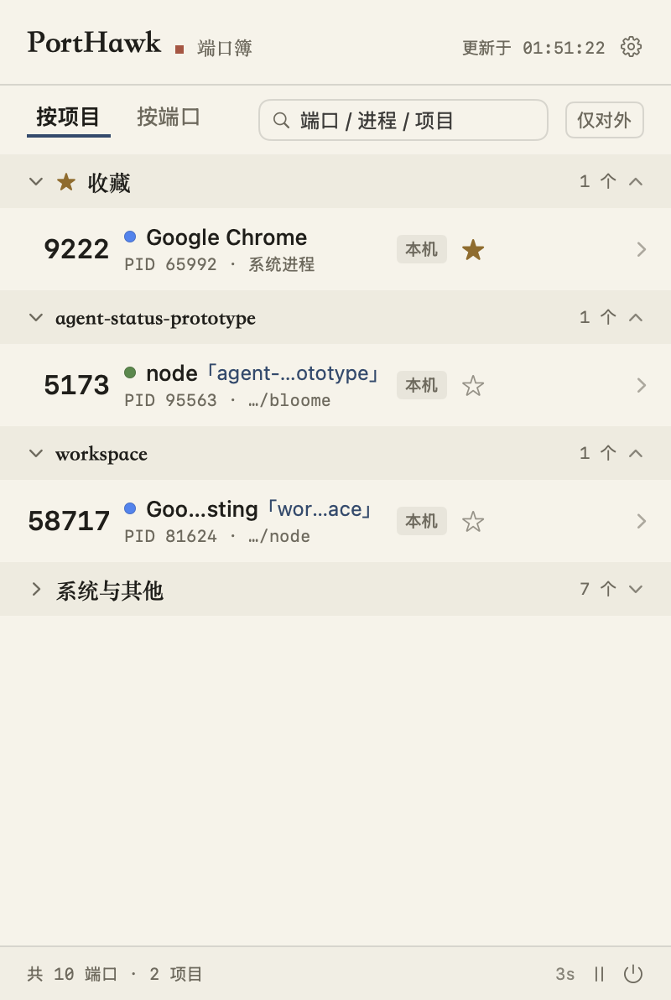
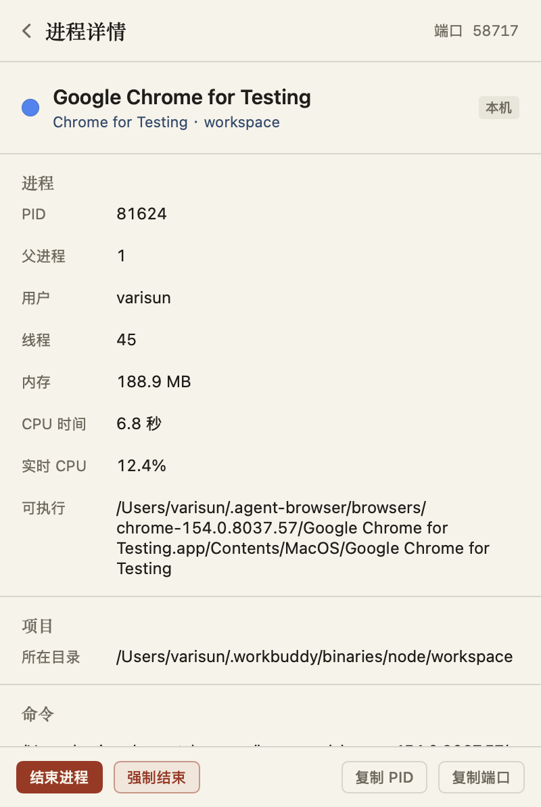
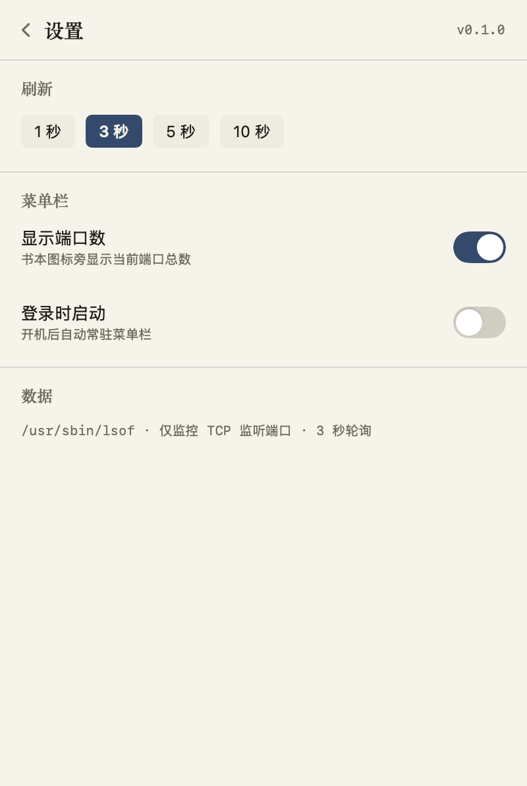

# PortHawk · Port Ledger

> A port ledger living in your macOS menu bar: **which app owns which port, which project runs which port** — at a glance.

[](https://github.com/volcanicll/PortHawk/actions/workflows/ci.yml)
[](https://github.com/volcanicll/PortHawk/releases/latest)
[](https://volcanicll.github.io/PortHawk/)

[中文说明](README.md) · **English**

**Install**: visit the [landing page](https://volcanicll.github.io/PortHawk/), or run one command to install the latest build:

```bash
curl -fsSL https://volcanicll.github.io/PortHawk/install.sh | bash
```



PortHawk is a native SwiftUI menu bar app (`MenuBarExtra`) — a single ~1 MB binary, no Electron, no runtime dependencies. It keeps a ledger of every TCP listening port on the machine: the port number sits in a left margin column like a page number, with process, project, PID and path on the right. Project ownership is inferred automatically from each process's working directory.

## Features

- **Ledger panel**: every TCP listening port in one ledger, hairline-ruled groups, serif titles, monospaced port numbers.
- **Two views**: "By project" groups ports under their owning project; "By port" lists favorites first, then everything else by port number.
- **Brand ink dots**: ~90 well-known dev-tool processes (node, python, redis-server, Code Helper…) get a brand-colored dot before their name.
- **Detail inspector**: click any row for a full page — complete command line, executable path, working directory, user, parent PID, threads, memory, cumulative and live CPU%; terminate or force-kill (SIGKILL) right there.
- **Two-step kill**: hover a row for "End"; the first click arms a solid "Confirm", the second one within 2.5 s sends the signal. A row being killed gets struck through with a vermilion line, like ink cancelling a ledger entry.
- **Favorites & placeholders**: star ports you care about; idle favorites show a faint "not in use" placeholder row, so a dead service is obvious at a glance.
- **Occupancy alerts**: when a favorited port gets taken by a new process, the menu bar icon lights a dot and the row gets a vermilion "占" seal; brand-new ports get a blue "新" seal.
- **Exposed / local badge**: ports bound to `0.0.0.0` / `*` (LAN-reachable) are marked ochre "对外", loopback-only ones gray "本机"; a "exposed only" chip filters them instantly.
- **Honest failures**: if lsof fails (including a 3 s timeout), the last snapshot is kept and the footer says so — it never pretends there are no ports.
- **Settings**: refresh interval (1/3/5/10 s), menu bar count toggle, launch at login (SMAppService).

## Screenshots

| Detail inspector | Settings |
| --- | --- |
|  |  |

## Build & Run

Requires macOS 13+ and Command Line Tools (full Xcode not needed).

```bash
./build.sh
open build/PortHawk.app
```

## Development & Diagnostics

```bash
# Data-layer self check, diffable against raw lsof output
./build/PortHawk.app/Contents/MacOS/PortHawk --cli

# Send a kill signal to a port (verifies the kill flow)
./build/PortHawk.app/Contents/MacOS/PortHawk --cli --kill-port 3000

# Floating preview window (real data, real interaction)
./build/PortHawk.app/Contents/MacOS/PortHawk --preview

# Screenshot verification: real / mocked states / detail / settings / menu bar icon
./build/PortHawk.app/Contents/MacOS/PortHawk --screenshot verify/real.png
./build/PortHawk.app/Contents/MacOS/PortHawk --screenshot-mock verify/mock.png
./build/PortHawk.app/Contents/MacOS/PortHawk --screenshot-mock-detail verify/detail.png
./build/PortHawk.app/Contents/MacOS/PortHawk --screenshot-mock-settings verify/settings.png
./build/PortHawk.app/Contents/MacOS/PortHawk --render-icon verify/icon.png 12 --alert
```

## Release Flow (GitHub Actions)

- **`ci.yml`**: builds `./build.sh` on a clean macOS runner whenever `Sources/` or `build.sh` change, or on PRs.
- **`release.yml`**: triggered by pushing a `v*` tag — injects the version from the tag into Info.plist → builds → produces DMG + zip → creates a GitHub Release with the artifacts.
- **`site-deploy.yml`**: deploys the landing page to GitHub Pages when `site/` changes. The page reads the latest version from the Releases API at runtime, so **shipping a new app version never requires redeploying the site**.

Everyday release: `git tag v0.x.0 && git push origin v0.x.0`.

## Data Sources & Limits

- Port list: `lsof -iTCP -sTCP:LISTEN -n -P -l +c0`, deduplicated by `(port, pid)` — IPv4/IPv6 dual-stack listeners count once (hence the small delta vs raw lsof rows).
- Project inference: `proc_pidinfo(PROC_PIDVNODEPATHINFO)` reads each process's working directory; system paths (`/System`, `/usr`, `/private/var`, `/tmp`…) and the home directory itself are not treated as projects.
- Only **your own** processes are fully visible: other users' processes expose no cwd/executable path (detail fields show `—`), and killing them requires sudo.
- TCP listeners only; UDP and outbound connections are out of the ledger's scope.
- lsof escapes spaces in command names as `\x20` (e.g. `Google\x20Chrome`); PortHawk unescapes them.

## Inspiration & Credits

**[Pulse](https://github.com/egoist/pulse)** (Go + WebView menu bar system monitor) — brand ink dots, the detail inspector, force-quit semantics and filter presets came from static analysis of its binary; its full-machine monitoring scope was deliberately left out.

**[PortBar](https://github.com/egoist/portbar)** (Swift menu bar port monitor) — favorite placeholder rows, keeping the last snapshot on scan failure, scan timeout, two-step kill confirmation, copyable sudo command, menu bar count badge, launch at login.

## Layout

```
Sources/
├── main.swift          Entry dispatch (menu bar app / CLI / screenshot & icon diagnostics)
├── Core/
│   ├── PortScanner.swift   lsof parsing + proc_pidinfo project inference & detail data + kill
│   ├── AppState.swift      Polling, snapshot diff, favorite alerts, grouping, detail sampling, pref migration
│   └── DevBrand.swift      Process brand catalog (~90 dev tools)
└── UI/
    ├── PanelViews.swift    Ledger panel, detail inspector, settings
    └── Theme.swift         Paper visual tokens (paper, ink, blue, vermilion, ochre)
```

Preferences live in UserDefaults (domain `app.porthawk.PortHawk`); upgrading from an older bundle id (`local.controlport.app`, `app.portpeek.PortPeek`) migrates favorites and settings automatically.

## License

[MIT](LICENSE)
